# DATABASE_AND_API_BLUEPRINT.md
### MySQL schema, data classification, REST contract and OpenAPI strategy

| | |
|---|---|
| **Date** | 2026-10-24 |
| **Engine** | MySQL 8.0+ (MariaDB 10.6+ compatibility to be confirmed — gate **A-1**) |
| **ORM** | Prisma 6 (`prisma migrate` for versioned DDL) |
| **API style** | REST/JSON, OpenAPI 3.1 generated from Zod schemas |
| **Scope** | Schema for layers A, B and C of `RAE_PLATFORM_ARCHITECTURE.md` |
| **Status** | Design only — no schema has been executed against any database |

---

## 1. Principles

| # | Principle | Rationale |
|---|---|---|
| P1 | `utf8mb4` everywhere, `utf8mb4_0900_ai_ci` collation (or `utf8mb4_thai_520_w2` for Thai sort columns `[U]`) | Thai text with tone marks + emoji-safe |
| P2 | ULID `char(26)` primary keys | sortable, non-guessable, URL-safe; no auto-increment leakage |
| P3 | Every FK is declared and indexed; `ON DELETE RESTRICT` by default, `CASCADE` only for owned children | referential integrity is a security control, not a nicety |
| P4 | Soft delete only where recovery matters (`deleted_at`); never for `audit_logs` | audit must be immutable |
| P5 | `created_at`, `updated_at` on every mutable table; `created_by`, `updated_by` where a human acts | cheap provenance |
| P6 | Money `decimal(14,2)`, never float; dates `date`, timestamps `datetime(3)` in UTC | correctness |
| P7 | Enums as `varchar(32)` + check constraint (portable, migratable) rather than native ENUM | avoids painful ALTERs |
| P8 | Sensitive columns encrypted at application level (`personnel_private`) | protects against dump leakage |
| P9 | No cross-database joins; the RDC warehouse and ERP are reached via ETL/link, never FK | boundaries |
| P10 | Legacy WTMS ids are stored only as `legacy_code varchar(64)` for traceability | directive C7 |

Naming: tables `snake_case` plural; columns `snake_case`; FK `<entity>_id`; unique `uq_<table>_<col>`; index `ix_<table>_<cols>`; check `ck_<table>_<rule>`.

---

## 2. Entity–relationship diagram (core)

```mermaid
erDiagram
  USERS ||--o{ SESSIONS : "has"
  USERS ||--o{ USER_ROLES : "assigned"
  ROLES ||--o{ USER_ROLES : "grants"
  ROLES ||--o{ ROLE_PERMISSIONS : "includes"
  PERMISSIONS ||--o{ ROLE_PERMISSIONS : "in"
  USERS ||--o{ MFA_FACTORS : "enrols"
  USERS ||--o{ AUDIT_LOGS : "acts"

  DEPARTMENTS ||--o{ DEPARTMENTS : "parent"
  DEPARTMENTS ||--o{ PERSONNEL : "employs"
  PERSONNEL ||--|| PERSONNEL_PRIVATE : "protects"
  PERSONNEL ||--o{ PERSONNEL_EDUCATION : "has"
  PERSONNEL ||--o{ PERSONNEL_TRAINING : "attends"

  MEDIA ||--o{ NEWS : "covers"
  NEWS_CATEGORIES ||--o{ NEWS : "classifies"
  NEWS ||--o{ NEWS_TAGS : "tagged"
  TAGS ||--o{ NEWS_TAGS : "labels"
  USERS ||--o{ NEWS : "authors"

  DOCUMENT_CATEGORIES ||--o{ DOCUMENTS : "groups"
  DOCUMENTS ||--o{ DOCUMENT_VERSIONS : "versions"
  DOCUMENTS ||--o{ DOCUMENT_DOWNLOADS : "counts"

  ASSETS ||--o{ ASSET_LOANS : "lends"
  ASSETS ||--o{ ASSET_REPAIRS : "repairs"
  VEHICLES ||--o{ VEHICLE_BOOKINGS : "booked"
  VEHICLES ||--o{ VEHICLE_MAINTENANCE : "serviced"
  ROOMS ||--o{ ROOM_BOOKINGS : "booked"

  FORMS ||--o{ FORM_FIELDS : "defines"
  FORMS ||--o{ FORM_SUBMISSIONS : "receives"
  FORM_SUBMISSIONS ||--o{ FORM_SUBMISSION_FILES : "attaches"
  COMPLAINTS ||--o{ COMPLAINT_MESSAGES : "thread"
  USERS ||--o{ NOTIFICATIONS : "receives"
  NOTIFICATIONS ||--o{ NOTIFICATION_DELIVERIES : "sent as"

  USERS {
    char26 id PK
    varchar email UK
    varchar password_hash
    varchar status
    datetime last_login_at
  }
  ROLES {
    char26 id PK
    varchar code UK
    varchar level
  }
  PERSONNEL {
    char26 id PK
    varchar employee_code UK
    char26 department_id FK
    boolean is_public
    datetime consent_at
  }
  PERSONNEL_PRIVATE {
    char26 personnel_id PK
    varbinary national_id_enc
    varbinary personal_phone_enc
  }
  DEPARTMENTS {
    char26 id PK
    varchar code UK
    char26 parent_id FK
    char26 head_personnel_id FK
  }
  NEWS {
    char26 id PK
    varchar slug UK
    char26 category_id FK
    varchar status
    datetime publish_at
  }
  DOCUMENTS {
    char26 id PK
    varchar code UK
    char26 category_id FK
    varchar visibility
    varchar storage_url
  }
  MEDIA {
    char26 id PK
    varchar path UK
    varchar mime
    int width
    int height
  }
  AUDIT_LOGS {
    char26 id PK
    char26 actor_id FK
    varchar action
    varchar entity_type
    char26 entity_id
  }
  NOTIFICATIONS {
    char26 id PK
    char26 user_id FK
    varchar channel
    datetime read_at
  }
```



Full table list (58 tables) in §3. The diagram shows the spine; join tables are listed but not drawn to keep it readable.

---

## 3. Table specification

### 3.1 Identity & access (10)

| Table | Key columns | Constraints / notes |
|---|---|---|
| `users` | `id`, `email` UK, `password_hash` (nullable for SSO-only), `display_name`, `photo_media_id`, `status` (`active|suspended|invited`), `mfa_enabled`, `last_login_at`, `failed_attempts`, `locked_until` | email lower-cased; SSO users get `external_subject` + `idp` columns |
| `roles` | `id`, `code` UK (`super_admin|admin|director|manager|officer|staff|guest`), `name_th`, `name_en`, `level` | seeded |
| `permissions` | `id`, `code` UK (`news:publish`), `resource`, `action` | seeded from a code-defined catalogue |
| `role_permissions` | `role_id`, `permission_id` | PK composite |
| `user_roles` | `user_id`, `role_id`, `department_id` (nullable = global) | PK composite; scope |
| `sessions` | `id`, `user_id`, `token_hash` UK, `ip`, `user_agent_hash`, `issued_at`, `last_seen_at`, `expires_at`, `revoked_at` | opaque token, SHA-256 at rest |
| `mfa_factors` | `id`, `user_id`, `type` (`totp|email`), `secret_enc`, `confirmed_at`, `last_used_at` | secret AES-GCM |
| `password_resets` | `id`, `user_id`, `token_hash` UK, `expires_at`, `used_at` | single use, 30 min |
| `login_attempts` | `id`, `email`, `ip`, `success`, `reason`, `created_at` | retention 90 d |
| `api_tokens` | `id`, `name`, `token_hash` UK, `scopes` JSON, `expires_at`, `last_used_at`, `created_by` | partner integrations |

### 3.2 Organization (6)

| Table | Key columns | Notes |
|---|---|---|
| `departments` | `id`, `code` UK, `name_th`, `name_en`, `parent_id`, `head_personnel_id` (nullable until M12), `description`, `logo_media_id`, `color`, `sort_order`, `is_active` | tree, max depth 3 |
| `personnel` | `id`, `employee_code` UK, `legacy_code`, `prefix_th`, `first_th`, `last_th`, `first_en`, `last_en`, `position_th`, `academic_rank`, `level`, `work_group`, `department_id`, `email`, `phone_office`, `photo_media_id`, `expertise` JSON, `is_public`, `consent_at`, `source` (`hr_sync|manual`), `synced_at` | public projection only when `is_public=1` |
| `personnel_private` | `personnel_id` PK/FK, `national_id_enc`, `birth_date`, `gender`, `address_enc`, `line_id_enc`, `facebook_url`, `personal_phone_enc` | **restricted**; app-level encryption |
| `personnel_education` | `id`, `personnel_id`, `level`, `degree`, `major`, `institution`, `year` | |
| `personnel_work_history` | `id`, `personnel_id`, `organization`, `position`, `start_year`, `end_year` | work history from `exitfull.txt #4` |
| `personnel_training` | `id`, `personnel_id`, `title`, `provider`, `year`, `hours` | |

### 3.3 Content (11)

| Table | Key columns | Notes |
|---|---|---|
| `media` | `id`, `path` UK, `bucket`, `mime`, `bytes`, `width`, `height`, `checksum`, `alt_th`, `alt_en`, `credit`, `uploaded_by`, `created_at` | alt required for non-decorative |
| `news` | `id`, `slug` UK, `category_id`, `title_th`, `title_en`, `summary_th`, `summary_en`, `body_th` (JSON blocks), `body_en`, `cover_media_id`, `status`, `publish_at`, `is_pinned`, `seo_title`, `seo_description`, `og_media_id`, `author_id`, `reviewed_by`, `published_by`, `legacy_code`, `deleted_at` | `status` = draft/review/approved/published/archived |
| `news_categories` | `id`, `slug` UK, `name_th`, `name_en`, `sort_order` | 4 content categories (+ an "all" view) from `EVIDENCE/notes/rae_home_outline.txt` |
| `tags` | `id`, `slug` UK, `name_th`, `name_en` | |
| `news_tags` | `news_id`, `tag_id` | PK composite |
| `pages` | `id`, `slug` UK, `section`, `title_th/en`, `body_th/en` (blocks), `status`, `reviewed_at`, `owner_department_id`, `legacy_code` | static pages |
| `events` | `id`, `slug` UK, `title_th/en`, `description_th/en`, `start_at`, `end_at`, `all_day`, `venue`, `room_id`, `registration_url`, `cover_media_id`, `status` | `.ics` generated |
| `faqs` | `id`, `question_th/en`, `answer_th/en`, `category`, `sort_order`, `is_active` | feeds `FAQPage` |
| `announcements` | `id`, `type` (`popup|banner|ticker`), `title`, `body`, `media_id`, `start_at`, `end_at`, `is_active`, `target_pages` JSON | schedule enforced in query |
| `menus` | `id`, `key` (`public_main|public_utility|footer`), `locale`, `items` JSON | cached; validated against routes |
| `redirects` | `id`, `from_path` UK, `to_path`, `status_code`, `hits`, `created_at`, `expires_at` | 301 map from legacy |

### 3.4 Documents & correspondence (5)

| Table | Key columns | Notes |
|---|---|---|
| `document_categories` | `id`, `code` UK, `name_th/en`, `folder`, `owner_group`, `description_th/en`, `sort_order`, `enabled` | 6 categories from `docs/document-center/taxonomy.json` |
| `documents` | `id`, `code` UK (`RAE-DC-####`), `legacy_code`, `category_id`, `title_th/en`, `owner_group`, `file_type`, `version`, `status` (`current|obsolete|archived|draft`), `visibility` (`public|internal|restricted`), `storage_url`, `onedrive_path`, `tags` JSON, `note`, `updated_date`, `verified_by`, `verified_at` | **files live in SharePoint**; URL host validated to `maejo365-my.sharepoint.com` |
| `document_versions` | `id`, `document_id`, `version`, `storage_url`, `changed_by`, `changed_at`, `change_note` | |
| `document_downloads` | `id`, `document_id`, `ip_hash`, `user_agent_hash`, `created_at` | count only, no PII |
| `correspondence` | `id`, `direction` (`in|out`), `doc_no`, `fiscal_year`, `doc_date`, `subject`, `sender`, `recipient`, `status`, `priority`, `storage_url`, `external_ref`, `qr_token` UK, `created_by` | `UNIQUE(fiscal_year, direction, doc_no)`; gapless numbering via a counter row. **No local file copy** — `storage_url` must point at `maejo365-my.sharepoint.com` (constraint C5) |

### 3.5 Operations (8)

| Table | Key columns | Notes |
|---|---|---|
| `assets` | `id`, `asset_code` UK, `name`, `category`, `brand`, `model`, `serial`, `price`, `fiscal_year`, `room_id`, `custodian_personnel_id`, `status`, `photo_media_id`, `qr_token` UK | only if ERP does not own it (gate A-6) |
| `asset_loans` | `id`, `asset_id`, `borrower_personnel_id`, `approved_by`, `borrowed_at`, `due_at`, `returned_at`, `status`, `note` | |
| `asset_repairs` | `id`, `asset_id`, `reported_by`, `reported_at`, `symptom`, `vendor`, `cost`, `status`, `completed_at` | |
| `vehicles` | `id`, `plate_no` UK, `brand`, `model`, `color`, `type`, `custodian_personnel_id`, `insurance_expiry`, `tax_expiry`, `inspection_expiry`, `status`, `photo_media_id` | expiry alerts |
| `vehicle_bookings` | `id`, `vehicle_id`, `requester_id`, `purpose`, `destination`, `start_at`, `end_at`, `passengers`, `status`, `approved_by`, `approved_at` | only if the existing system lacks approval |
| `vehicle_maintenance` | `id`, `vehicle_id`, `service_date`, `type`, `cost`, `vendor`, `odometer`, `note` | |
| `rooms` | `id`, `code` UK, `name`, `building`, `floor`, `capacity`, `equipment` JSON, `photo_media_id`, `is_active` | |
| `room_bookings` | `id`, `room_id`, `requester_id`, `title`, `start_at`, `end_at`, `attendees`, `status`, `approved_by`, `external_ref` | mirror only if integration is unavailable |

### 3.6 Engagement (9)

| Table | Key columns | Notes |
|---|---|---|
| `forms` | `id`, `slug` UK, `title_th/en`, `description`, `status`, `version`, `submit_message`, `notify_emails` JSON | version bump freezes old definition |
| `form_fields` | `id`, `form_id`, `key`, `type`, `label_th/en`, `placeholder_th/en`, `help_th/en`, `required`, `options` JSON, `validation` JSON, `conditional` JSON, `sort_order` | 10 types incl. `signature` |
| `form_submissions` | `id`, `form_id`, `submitted_by` (nullable), `data` JSON, `status`, `ip_hash`, `created_at` | validated against the form version |
| `form_submission_files` | `id`, `submission_id`, `field_key`, `media_id` | |
| `complaints` | `id`, `tracking_code` UK, `category`, `subject`, `detail`, `contact_name`, `contact_email`, `contact_phone`, `is_anonymous`, `status`, `priority`, `assigned_to`, `sla_due_at`, `closed_at` | tracking code = 10 chars, non-sequential |
| `complaint_messages` | `id`, `complaint_id`, `author_type` (`staff|reporter`), `author_id`, `body`, `is_internal`, `created_at` | internal notes never exposed |
| `notifications` | `id`, `user_id`, `type`, `title`, `body`, `link`, `read_at`, `created_at` | |
| `notification_deliveries` | `id`, `notification_id`, `channel`, `status`, `error`, `sent_at` | |
| `contact_messages` | `id`, `name`, `email`, `phone`, `subject`, `message`, `status`, `ip_hash`, `handled_by`, `created_at` | public contact form (M07) |

### 3.7 Supporting (9)

| Table | Purpose |
|---|---|
| `notification_preferences` | per-user channel × event-type opt-in |
| `settings` | `key` PK, `value` JSON, `group`, `is_secret`, `updated_by` |
| `audit_logs` | append-only: `actor_id`, `action`, `entity_type`, `entity_id`, `before` JSON, `after` JSON, `ip`, `user_agent`, `request_id`, `created_at` |
| `jobs` | `type`, `payload` JSON, `status`, `attempts`, `run_at`, `locked_at`, `finished_at`, `error` |
| `backups` | `filename`, `bytes`, `checksum`, `created_at`, `retention_until`, `verified_at` |
| `ai_interactions` | feature, model, token counts, latency; **prompt hash only**, never prompt text with PII |
| `search_entries` | cross-entity search index (`entity_type`, `entity_id`, `locale`, `title`, `body`, `keywords`, `url`, `weight`) |
| `analytics_events` | first-party page views: `path`, `locale`, `event_type`, `referrer_host`, `device_class`, `session_hash`, `created_at` (no IP, no user id) |
| `kpi_stats` | published statistics: `key`, `label_th/en`, `value`, `unit`, `source`, `as_of`, `is_published` — the source behind `/public/stats` and the homepage strip |

**Total: 58 tables** (10 + 6 + 11 + 5 + 8 + 9 + 9).

---

## 4. Indexing and search

| Need | Index |
|---|---|
| Slug lookups | `uq_news_slug`, `uq_pages_slug`, `uq_events_slug`, `uq_documents_code` |
| Public listings | `ix_news_status_publish_at (status, publish_at DESC)`, `ix_events_start_at`, `ix_documents_status_visibility` |
| Department scoping | `ix_personnel_department`, `ix_user_roles_department` |
| Audit queries | `ix_audit_created_at`, `ix_audit_actor_created (actor_id, created_at)` |
| Bookings overlap check | `ix_room_bookings_room_time (room_id, start_at, end_at)` + service-level overlap transaction |
| Notifications | `ix_notifications_user_read (user_id, read_at)` |
| Sessions | `uq_sessions_token`, `ix_sessions_user` |
| Full-text | `FULLTEXT idx_ft_search (title, body, keywords) WITH PARSER ngram` on `search_entries` |

**Cross-entity search** is a materialised `search_entries` table (`entity_type`, `entity_id`, `locale`, `title`, `body`, `url`, `weight`, `updated_at`), rebuilt by a job on publish. Reasons: (1) one query, one ranking model; (2) Thai ngram works without word spaces; (3) no cross-table UNION at request time. If recall on the 30-query fixture is < 90 %, escalate to Meilisearch (deferred decision).

---

## 5. Data classification and retention

| Class | Examples | Controls | Retention |
|---|---|---|---|
| **Public** | news, pages, public documents, events, public personnel projection | readable without auth, cacheable | until superseded + 3 y archive |
| **Internal** | draft content, correspondence metadata, assets, bookings, form submissions | auth + permission | 5 y |
| **Restricted** | `personnel_private`, national id, address, personal phone, complaints identity | encryption + `hr:*` / `complaint:*`; no API exposure | per PDPA schedule; deletion on request |
| **System** | sessions, login attempts, audit logs, backups | ops only | sessions 30 d post-expiry · attempts 90 d · audit 2 y · backups 30 d rolling + 12 monthly |

PDPA obligations encoded: purpose field in `settings` documentation, consent timestamp on public directory entries, DSAR export/delete routine, breach register table `[U]` to be added with legal input.

---

## 6. API design

### 6.1 Conventions

| Aspect | Rule |
|---|---|
| Base | `/api/v1` |
| Content type | `application/json; charset=utf-8`; uploads `multipart/form-data` |
| Naming | plural resources, kebab-case paths, camelCase JSON |
| IDs | ULID strings |
| Pagination | `?page=1&pageSize=20` (max 100); response `meta {page,pageSize,total,totalPages}` |
| Filtering | `?status=published&category=news&from=2026-01-01`; comma = OR, repeat = AND |
| Sorting | `?sort=-publishAt,title` (`-` = desc), allow-list per endpoint |
| Sparse fields | `?fields=id,title,slug` |
| Envelope (success) | `{ "data": …, "meta": {…}, "requestId": "…" }` |
| Envelope (error) | `{ "error": { "code": "VALIDATION_FAILED", "message": "…", "details": [{ "field": "title", "code": "required" }] }, "requestId": "…" }` |
| Idempotency | `Idempotency-Key` header on all POST/PATCH that create side effects |
| Caching | public GET: `Cache-Control: public, s-maxage=300, stale-while-revalidate=600` (carried from the existing contracts) |
| Versioning | path version; additive changes only within v1; deprecation via `Sunset` header + 90 days |

### 6.2 Authentication & authorisation

| Client | Mechanism |
|---|---|
| Admin UI | DB-backed session cookie `__Host-rae_admin` + CSRF token on mutations |
| Partner API | Bearer **JWT** access token (15 min, `sub`, `scope[]`, `aud`, `jti`) issued by `/api/v1/auth/token` from client credentials; refresh token stored hashed in `api_tokens`, revocable |
| Public read API | no auth; optional `X-Api-Key` for higher quota |
| Webhooks (outbound) | HMAC-SHA256 signature + timestamp |

Authorisation is always re-checked server-side against the permission catalogue; a valid token with a wrong scope returns `403 FORBIDDEN`.

### 6.3 Endpoint catalogue

**Public (read, cached, no auth)**

| Method | Path | Purpose |
|---|---|---|
| GET | `/public/pages/{slug}` | page content |
| GET | `/public/news` · `/public/news/{slug}` | news list/detail |
| GET | `/public/categories` | news categories |
| GET | `/public/events` · `/public/events/{slug}` · `/public/events/{slug}/ics` | events + calendar export |
| GET | `/public/announcements` | active announcements |
| GET | `/public/documents` · `/public/documents/{code}` · `/public/document-categories` | document center |
| GET | `/public/services` | service catalogue |
| GET | `/public/personnel` | **public projection only** |
| GET | `/public/systems` | systems directory |
| GET | `/public/faqs` | FAQ |
| GET | `/public/search?q=` | grouped search |
| GET | `/public/stats` | published KPIs (with `source`,`asOf`) |
| POST | `/public/contact` | contact form (rate-limited, captcha on abuse) |
| POST | `/public/complaints` | file a complaint |
| GET | `/public/complaints/{trackingCode}` | status (no PII in response) |
| POST | `/public/forms/{slug}/submit` | dynamic form submission |
| GET | `/public/health` | liveness |

**Auth**

| Method | Path | Purpose |
|---|---|---|
| GET | `/api/auth/signin` · `/api/auth/callback/entra` · `/api/auth/session` · POST `/api/auth/signout` | OIDC + session |
| POST | `/api/auth/mfa/enrol` · `/api/auth/mfa/verify` | TOTP |
| POST | `/api/v1/auth/token` · `/api/v1/auth/refresh` · `/api/v1/auth/revoke` | partner JWT lifecycle |

**Admin (session + permission)**

| Resource | Endpoints |
|---|---|
| Users & roles | `GET/POST /api/v1/admin/users`, `GET/PATCH/DELETE /api/v1/admin/users/{id}`, `POST /api/v1/admin/users/{id}/reset-password`, `GET /api/v1/admin/roles`, `PATCH /api/v1/admin/roles/{id}/permissions`, `POST /api/v1/admin/users/{id}/roles` |
| Departments | `GET/POST /api/v1/admin/departments`, `GET/PATCH/DELETE /api/v1/admin/departments/{id}`, `POST /api/v1/admin/departments/reorder` |
| Personnel | `GET/POST /api/v1/admin/personnel`, `GET/PATCH /api/v1/admin/personnel/{id}`, `GET /api/v1/admin/personnel/{id}/private`, `POST /api/v1/admin/personnel/sync` |
| News | `GET/POST /api/v1/admin/news`, `GET/PATCH/DELETE /api/v1/admin/news/{id}`, `POST /api/v1/admin/news/{id}/submit|approve|publish|unpublish` |
| Pages / events / announcements / faqs | standard CRUD + `POST /{id}/publish` |
| Media | `POST /api/v1/admin/media` (multipart), `GET /api/v1/admin/media`, `PATCH /api/v1/admin/media/{id}` (alt), `DELETE /api/v1/admin/media/{id}` |
| Documents | CRUD + `POST /api/v1/admin/documents/{id}/versions`, `GET /api/v1/admin/documents/{id}/downloads` |
| Correspondence | CRUD + `POST /api/v1/admin/correspondence/{id}/status`, `GET /api/v1/admin/correspondence/{id}/qr` |
| Assets / vehicles / rooms | CRUD + `POST /{id}/loans`, `POST /{id}/bookings`, `POST /{id}/approve|reject` |
| Forms | CRUD + `GET /api/v1/admin/forms/{id}/submissions`, `GET /api/v1/admin/forms/{id}/export?format=xlsx|pdf` |
| Complaints | list/detail, `POST /api/v1/admin/complaints/{id}/messages`, `POST /api/v1/admin/complaints/{id}/status` |
| Reports | `GET /api/v1/admin/reports/{module}?format=json|xlsx|pdf|csv|docx`, `GET /api/v1/admin/reports/jobs/{id}` |
| Settings / audit / backups | `GET/PATCH /api/v1/admin/settings`, `GET /api/v1/admin/audit-logs`, `POST /api/v1/admin/backups`, `POST /api/v1/admin/backups/{id}/restore` |
| Tokens / search ops | `GET/POST/DELETE /api/v1/admin/tokens`, `POST /api/v1/admin/search/reindex` |

**Ops**

| Method | Path | Purpose |
|---|---|---|
| GET | `/healthz` · `/readyz` | probes |
| POST | `/api/revalidate` | CMS → public ISR invalidation (HMAC) |
| GET | `/api/v1/admin/docs` · `/api/v1/admin/openapi.json` | Swagger UI + schema (admin-only) |

### 6.4 Error codes

| HTTP | Code | When |
|---|---|---|
| 400 | `VALIDATION_FAILED` | schema violation, with field details |
| 401 | `UNAUTHENTICATED` | no/invalid session or token |
| 403 | `FORBIDDEN` | authenticated but missing permission/scope |
| 404 | `NOT_FOUND` | unknown id/slug or not visible to caller |
| 409 | `CONFLICT` | duplicate slug/code, booking overlap, stale version |
| 413 | `PAYLOAD_TOO_LARGE` | upload over cap |
| 415 | `UNSUPPORTED_MEDIA_TYPE` | MIME not in allow-list |
| 422 | `BUSINESS_RULE_VIOLATION` | e.g. approve own request, close without reply |
| 429 | `RATE_LIMITED` | quota exceeded, `Retry-After` set |
| 500 | `INTERNAL` | unhandled; `requestId` only, no stack |
| 502/503 | `UPSTREAM_UNAVAILABLE` | integration circuit open |

### 6.5 Rate limits

| Surface | Limit |
|---|---|
| Public GET | 120 req/min/IP |
| Public POST (contact, complaint, form) | 5 req/min/IP + 20/hour/session |
| Search | 30 req/min/IP |
| Admin API | 600 req/min/user |
| Auth endpoints | 10 req/min/IP; 5 failures → 15 min lock |
| Reports/export | 10 req/hour/user |
| Partner API | per-token quota in `api_tokens.scopes` |

### 6.6 OpenAPI strategy

- One Zod schema per request/response in `src/modules/<module>/schema.ts`.
- `zod-to-openapi` generates `/api/v1/admin/openapi.json` at build; CI fails if a route lacks a schema or the document is invalid.
- Swagger UI served at `/api/v1/admin/docs` behind `admin` permission (never public).
- Contract tests assert response shapes against the generated schema.

---

## 7. Data flow: publish → public

```
Admin save (server action)
  → validate (zod) → policy check → DB write → audit row
  → enqueue job "revalidate" {entity, id}
Worker
  → rebuild search_entries row
  → POST /api/revalidate (HMAC) to the public app
Public app
  → revalidateTag(`news:${id}`) / revalidatePath('/th/news')
  → next request regenerates the static page
```

Failure handling: if revalidation fails, the page serves stale content for ≤ `revalidate` seconds and the job retries with backoff; publishing is never blocked by cache invalidation.

---

## 8. Migration from legacy content

| Step | Detail |
|---|---|
| 1 | **No WTMS DB connection.** Content is re-authored or imported from exported manifests only (constraint C7) |
| 2 | Build a `legacy_map` CSV: `legacy_url → new_url → status_code → owner → verified_at` |
| 3 | Import available curated data: `docs/document-center/registry/*.json` (11 records), `data/news-registry.ts`, service catalogues, personnel contacts |
| 4 | Map old ids to `legacy_code` columns; new ids are ULIDs |
| 5 | Validate: every `documents.storage_url` host = `maejo365-my.sharepoint.com`; every `code` matches `^RAE-DC-\d{4}$`; 0 duplicate slugs |
| 6 | Seed `redirects` from the map, then crawl staging to prove 0 chains/loops/404s |
| 7 | Freeze the legacy site read-only for 12 months; no DNS change without gate A-1 |

---

## 9. Known gaps

- `utf8mb4_thai_520_w2` availability and ngram recall must be tested on the actual engine `[U]`.
- `settings` secret handling needs a KMS/age key decision `[U]`.
- No schema for a breach register or DPIA record yet — add with legal input `[U]`.
- Booking overlap enforcement is application-level; a DB-level exclusion constraint is not portable to MySQL and is therefore a documented trade-off.
- Person-level audit retention vs the 2-year default needs HR confirmation `[U]`.
