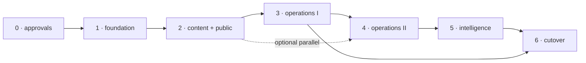

# DEVELOPMENT_ROADMAP.md
### Phased delivery, CI/CD, testing and approval gates

| | |
|---|---|
| **Date** | 2026-10-24 |
| **Target** | `RAE Digital Platform` — public site + CMS/admin + modular systems |
| **Architecture** | Option 1 (modular monolith) — `RAE_PLATFORM_ARCHITECTURE.md §8` |
| **Module scope** | 29 modules — `MODULE_REQUIREMENTS_MATRIX.md` |
| **Status** | Planning only. **No implementation has started.** |

---

## 1. Delivery principles

1. **Phase 0 is not optional.** Nothing is built until hosting, SSO, engine and PDPA decisions are recorded (gates A-1…A-7).
2. **Vertical slices, not horizontal layers.** Each phase ships modules end-to-end (schema → policy → service → UI → tests → audit) instead of “all models, then all pages”.
3. **The legacy site stays live and untouched** until Phase 6. No in-place mutation, no shared database.
4. **Every phase is demoable to a named owner** and has measurable exit criteria; a phase that cannot be demoed is not done.
5. **Public quality gates are enforced in CI**, not by review memory: contrast pairs, axe, Lighthouse budget, OpenAPI presence, `href="#"` guard.

---

## 2. Phase map

| Phase | Name | Duration | Modules | Exit gate |
|---|---|---|---|---|
| **0** | Architecture & approvals | 2–3 weeks | — | A-0…A-7 recorded; hosting + SSO + engine confirmed |
| **1** | Foundation | 6 weeks | M01, M10, M11, M13, M15, M20, M21 | Staff can log in, manage users/departments/media, and see an audited change |
| **2** | Content & public site | 8 weeks | M02, M03, M04, M05, M06, M07, M08, M12, M14, M17, M18, M22, M23 | Public site fully driven by the CMS, searchable, bilingual, indexed, backed up |
| **3** | Operations I | 6 weeks | M16, M19, M31, M32, M35, M36 | Letters, reports, bookings, complaints and notifications in daily use |
| **4** | Operations II | 6 weeks | M30, M34 | Assets (or ERP integration) and dynamic forms live |
| **5** | Intelligence | 4–6 weeks | M37 | AI features behind flags with audit + cost cap |
| **6** | Cutover | 3–4 weeks | — | Production at the final domain, legacy read-only, redirects verified |

**Total: 35–39 weeks** with the team in §3. Sequential; Phases 3 and 4 may overlap by 2 weeks if two developers work separate modules.

### Phase dependency graph



---

## 3. Team and effort

| Role | Allocation | Responsibility |
|---|---|---|
| Product owner (RAE deputy director) | 20 % | priorities, acceptance sign-off, content ownership |
| Architect / lead developer | 100 % | schema, auth, module contracts, reviews, releases |
| Full-stack developer | 100 % | modules, admin UI, tests |
| Designer | 40 % (phases 1–2), 10 % after | design-system application, admin UI, asset QA |
| QA / accessibility | 30 % | test plans, axe/manual a11y, UAT coordination |
| Content editor (RAE) | 50 % (phase 2+) | content migration, Thai/EN copy, taxonomy |
| IT operations (MJU/VPS) | 20 % | hosting, TLS, DB, backups, monitoring |

Effort estimate (person-weeks):

| Workstream | P0 | P1 | P2 | P3 | P4 | P5 | P6 | Total |
|---|:--:|:--:|:--:|:--:|:--:|:--:|:--:|:--:|
| Architecture & design | 3 | 2 | 1 | 1 | 1 | 1 | 1 | 10 |
| Backend / data | — | 5 | 6 | 6 | 5 | 3 | 1 | 26 |
| Frontend public | — | 3 | 6 | 1 | 1 | 1 | 1 | 13 |
| Frontend admin | — | 4 | 4 | 4 | 4 | 2 | — | 18 |
| Content migration | — | — | 5 | 1 | 1 | — | 2 | 9 |
| QA / a11y / security | 1 | 1 | 2 | 2 | 2 | 1 | 2 | 11 |
| Ops / CI/CD | 1 | 2 | 1 | 1 | 1 | 1 | 2 | 9 |
| **Total** | **5** | **17** | **25** | **16** | **15** | **9** | **9** | **96** |

Add 20 % contingency → **≈ 115 person-weeks**. Against the allocation in this section (≈ 3.6 FTE over the schedule) that is ≈ 126 person-weeks of capacity for 35–39 calendar weeks, leaving headroom for approvals, rework and part-time roles that cannot work in parallel. A single-developer team roughly doubles the calendar and removes that headroom.

---

## 4. Phase detail

### Phase 0 — Architecture & approvals (2–3 weeks)

| Task | Output |
|---|---|
| Enrol a dedicated Agent Core project identity | `AGENT_CORE_CONNECTED` for this project (currently `PROJECT_ENROLLMENT_REQUIRED`) |
| Confirm hosting: Node runtime, CPU/RAM/disk, MySQL vs MariaDB version, TLS owner | signed note in `docs/adr/` |
| Confirm SSO: Entra ID OIDC redirect URIs, group claims, test tenant | integration test login |
| Confirm PDPA basis for personnel directory | DPIA note |
| Confirm which systems own assets/rooms/vehicles | integration decisions |
| Confirm Stitch V2 vs V6 | design baseline note |
| Repository created with branch protection, CI skeleton, ADR-0001 | repo |

**Exit:** all eight gates (A-0…A-7) recorded with a named owner and date. **Only then** Phase 1 starts.

### Phase 1 — Foundation (6 weeks)

| Week | Deliverable |
|---|---|
| 1 | Repo scaffold (structure from `RAE_PLATFORM_ARCHITECTURE.md §12`), tokens, Tailwind config, lint/format, CI skeleton |
| 2 | Prisma schema for identity + org; migrations; seed roles/permissions/settings |
| 3 | Auth (OIDC + credentials), sessions, MFA, middleware guard, `requirePermission` |
| 4 | Admin shell (sidebar, topbar, dark mode, skeleton), users/roles UI |
| 5 | Departments, media pipeline (upload → derivatives → storage), settings |
| 6 | Audit log, backup job, public shell with tokens + real nav + locale routing |

**Exit criteria:** a staff account logs in via SSO (or credentials+TOTP in the fallback path); creating a user writes an audit row; media upload produces 4 derivatives with alt text required; `/th/` renders the Stitch shell with 7 working nav links; axe = 0 violations on login + users list; CI green.

### Phase 2 — Content & public site (8 weeks)

| Week | Deliverable |
|---|---|
| 7 | Content schema (news/pages/events/faqs/announcements), media picker, rich text |
| 8 | News CRUD + workflow + revisions + scheduling |
| 9 | Pages, FAQ, announcements/banners, menus |
| 10 | Public homepage from CMS; section components wired; statistics with provenance |
| 11 | Document Center (DB-backed), knowledge pages, events + `.ics` |
| 12 | Search (`search_entries` + ngram), sitemap/robots/JSON-LD, `hreflang` |
| 13 | Personnel public projection + HR sync; contact form; dashboard v1 |
| 14 | Public API + OpenAPI, backups, performance and a11y pass, UAT |

**Exit criteria:** every public page is CMS-driven (0 hardcoded copy); 30-query Thai search fixture ≥ 90 % hit; sitemap validates; 0 AA contrast failures; Lighthouse mobile ≥ 90 performance/100 a11y/100 SEO; publish → ISR revalidation ≤ 5 s; restore from backup demonstrated.

### Phase 3 — Operations I (6 weeks)

Correspondence registry (gapless numbering), reports/exports for modules with data, vehicle and room integration (deep-link + approval layer only if missing), complaints with tracking code and SLA, notifications (in-app + email).

**Exit:** a letter is registered, numbered, QR-resolved and exported; a complaint is filed anonymously, tracked by code, replied to and closes with an email; a report exports to XLSX and PDF matching on-screen filters; expiring vehicle documents raise alerts 30 days ahead.

### Phase 4 — Operations II (6 weeks)

Assets (or ERP integration) with loans/repairs/QR labels; dynamic form builder with 10 field types, conditional logic, signature, exports.

**Exit:** an asset loan is requested, approved and returned with full history; a form is built by a non-developer, published, submitted with a file, exported to XLSX; form versioning freezes an old definition.

### Phase 5 — Intelligence (4–6 weeks, optional)

AI gateway, retrieval over approved public content only, summarisation of reports, drafting assistance for news, admin Q&A, dashboard narrative.

**Exit:** provider-agnostic interface with one implementation; every call audited; no PII in prompts (test); monthly cost cap enforced; AI-drafted content requires human approval; feature flags per capability.

### Phase 6 — Cutover (3–4 weeks)

Redirect map applied, DNS/TLS switch, legacy site frozen read-only, monitoring, 2-week hypercare.

**Exit:** 0 404s in a crawl of the top 500 legacy URLs; `hreflang` valid; Search Console change-of-address submitted; rollback rehearsed; runbook signed.

---

## 5. CI/CD

```
pull request
  ├─ lint (eslint + stylelint: no raw hex, no href="#")
  ├─ typecheck (tsc --noEmit)
  ├─ unit tests (vitest)
  ├─ integration tests (MySQL 8 service container, migrations applied)
  ├─ contract tests (zod → OpenAPI diff, response shapes)
  ├─ build (next build, standalone)
  ├─ a11y (axe on key routes, contrast pair test)
  ├─ lighthouse budget (LCP/CLS/TBT/transfer)
  └─ security (npm audit, secret scan, dependency review)

merge to main
  ├─ build artefact (immutable, sha-tagged)
  ├─ deploy to staging (auto)
  ├─ smoke tests (health, login, publish, search)
  └─ manual approval ──► deploy to production (blue/green alias switch)
```

| Concern | Decision |
|---|---|
| Branching | trunk-based, short-lived branches, PR review required |
| Migrations | forward-only; destructive changes need a two-step deploy (expand → contract) |
| Rollback | previous artefact + alias switch; DB rollback only from a verified dump |
| Secrets | environment-injected; never in the repo; rotation documented |
| Deploy window | outside 08:30–16:30 ICT on weekdays; never before an announced event |
| Environments | `dev` local · `staging` (basic auth + `noindex`) · `prod` |

---

## 6. Testing strategy

| Level | Scope | Tool | Gate |
|---|---|---|---|
| Unit | pure functions, policies, validators, formatters | Vitest | ≥ 80 % on `service/policy/schema` |
| Integration | repositories + migrations + permission enforcement | Vitest + MySQL container | 100 % of modules with a DB write path |
| Contract | request/response vs OpenAPI | zod + schema diff | every `/api/v1` route |
| E2E | 12 critical journeys: login · publish news · upload media · upload document · create user · register letter · file complaint · build form · submit form · export report · book room · public search | Playwright | must pass on staging |
| Accessibility | axe on 10 key routes + keyboard walkthrough + contrast pairs | axe-core + `tools/contrast_*.py` | 0 violations |
| Performance | Lighthouse mobile on 5 public routes | LHCI | budget from `RAE_PLATFORM_ARCHITECTURE.md §11` |
| Security | dependency audit, secret scan, authz matrix test (every role × every admin route) | npm audit + custom | 0 critical/high; 0 unauthorised 200s |
| Data | seed fixtures incl. Thai text, edge dates, empty states | fixtures | deterministic |

**Required fixtures:** Thai text without spaces, long Thai titles, Buddhist-era dates, files at the size cap, a department with no staff, a form with 30 fields, an asset with 50 loan records.

---

## 7. Definition of Done (per module)

1. Schema migrated, seeded, and covered by integration tests.
2. Permission declared in the catalogue; enforcement test proves 403 without it.
3. All mutations write audit rows (test asserts).
4. UI states: loading, empty, error, success — each verified.
5. Keyboard-only pass on the module’s primary flow.
6. axe = 0 on the module’s routes; contrast pairs pass.
7. Thai + English labels complete (no hardcoded strings in components).
8. OpenAPI entries present (if it exposes an API).
9. Runbook note added (`docs/runbooks/`).
10. Demo to the module owner with sign-off recorded.

---

## 8. Risks specific to delivery

| # | Risk | Likelihood | Impact | Mitigation | Owner |
|---|---|:--:|:--:|---|---|
| D-1 | Phase 0 decisions slip (hosting/SSO) | High | Blocks all | Time-box to 3 weeks; start Phase 1 scaffolding that is decision-independent | PO |
| D-2 | Single developer | High | Schedule doubles | Prioritise P0; buy design/QA help; no bespoke infra | PO |
| D-3 | Content migration underestimated | High | Launch delay | Start content inventory in Phase 1; migrate in batches; editor assigned early | Editor |
| D-4 | Requirement creep from 29 modules | High | Never ships | Matrix + DEFER list; change control at phase gates | PO |
| D-5 | Thai search quality | Medium | Poor UX | ngram prototype in Phase 2 week 1; fixture test; Meilisearch escape hatch | Architect |
| D-6 | Auth complexity (SSO + local + MFA) | Medium | Security gap | Build local first, add OIDC behind a flag | Architect |
| D-7 | Personnel data legality | Medium | Legal exposure | DPIA before Phase 2; consent model; split tables | PO + legal |
| D-8 | Duplicating existing systems | Medium | Wasted effort | Gate A-6 decisions before Phase 3 | PO |
| D-9 | Accessibility regressions | Medium | Compliance | CI gates + per-release manual pass | QA |
| D-10 | Cutover traffic loss | Medium | SEO | Redirect map, staged rollout, 12-month legacy retention | Architect |

---

## 9. Approval gates

| Gate | Question | Owner | Blocks |
|---|---|---|---|
| **A-0** | Dedicated Agent Core project identity enrolled? | platform owner | authoritative audit trail |
| **A-1** | Node runtime + MySQL version + TLS/backup target approved? | MJU IT | Phase 1 deploy |
| **A-2** | Stitch V2 confirmed as design baseline (vs V6)? | RAE director | design work |
| **A-3** | Entra ID OIDC contract + test account available? | MJU IT / identity | SSO |
| **A-4** | PDPA basis for personnel directory + retention approved? | RAE + legal | M12 |
| **A-5** | Scope of release 1 (P0 modules) signed? | RAE director | Phase 2 |
| **A-6** | Asset/room/vehicle ownership decided (integrate vs build)? | RAE + IT | Phase 3–4 |
| **A-7** | KPI statistics source + publication rule approved? | RAE director | M02 |

**All gates are currently open.** A-0 is **blocked** (`PROJECT_ENROLLMENT_REQUIRED`).

---

## 10. What Phase 1 would deliver (recommended first implementation phase)

Six weeks, dependent only on **A-1** (hosting) and **A-3** (SSO) to deploy the login path; **A-2** (Stitch V2 vs V6) is not needed until Phase 2 section composition:

1. Repository + CI + tokens + design-system enforcement.
2. Prisma schema for identity/organisation; migrations; seed data.
3. Authentication (local credentials + Argon2id + TOTP), session management, middleware guard, permission catalogue.
4. Admin shell with dark mode, users/roles management, audit trail.
5. Departments and media library with derivatives.
6. Settings (SMTP, identity, maintenance mode) and a job runner with a scheduled-task skeleton (the backup job itself is M22 in Phase 2).
7. Public shell using Stitch V2 tokens with 7 working nav routes and correct `<html lang>`.

**Why this first:** every later module depends on identity, organisation, media and audit, and this phase is the only one that can proceed while A-2/A-4/A-5/A-6 are still being negotiated. It also removes the two biggest inherited defects (no auth at all; a design system without enforced tokens).
