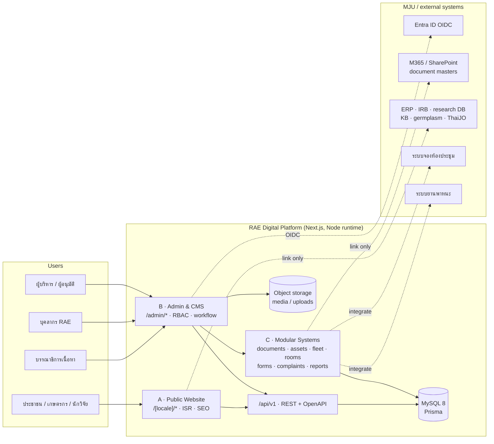
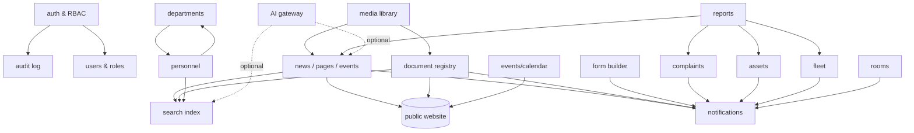

# RAE_PLATFORM_ARCHITECTURE.md
### RAE Digital Platform — public website, CMS/administration, and modular organization systems

| | |
|---|---|
| **Version** | 1.0 — for review (no implementation performed) |
| **Date** | 2026-10-24 |
| **Inputs** | `exitfull.txt` (functional inventory), `LEGACY_REUSE_ASSESSMENT.md`, `REFERENCE_AUDIT.md`, `RAE_REDESIGN_BLUEPRINT.md` |
| **Status** | `RAE_ARCHITECTURE_READY_FOR_REVIEW` |
| **Blocker** | **`PROJECT_ENROLLMENT_REQUIRED`** — no dedicated RAE Agent Core project identity (see `ARCHITECTURE_QA.md §1`) |

**Evidence convention:** `[V]` verified in this session from code/files · `[V*]` verified in the prior audit session and reused from `EVIDENCE/` · `[A]` assumption · `[U]` unverified, needs an owner decision.

---

## 1. Drivers and constraints

### 1.1 Functional drivers (from `exitfull.txt`)

`exitfull.txt` is a PHP/MySQL/Bootstrap/AdminLTE specification for a full organization information system. Per directive it is a **functional inventory, not a technology choice**. It enumerates roughly **30 capability blocks** (31 `⸻` separators) spanning dashboard, login/roles, users, personnel, departments, news, correspondence, assets, fleet, meeting rooms, calendar, document library, announcements, dynamic forms, complaints, contact, reports, notifications, public website, settings, logs/audit, database/ER, UI, dashboard widgets, search, API, security, backup, uploads and AI. Every block is traced 1:1 in `MODULE_REQUIREMENTS_MATRIX.md §5`.

### 1.2 Hard constraints

| # | Constraint | Source | Consequence |
|---|---|---|---|
| C1 | **No PHP runtime, no PHP-dependent libraries** | directive | AdminLTE/Bootstrap-PHP stack rejected; Tailwind + React admin shell instead |
| C2 | Next.js App Router + TypeScript baseline | directive, `package.json [V]` | Keeps the existing front-end skill and the Stitch V2 components |
| C3 | MySQL + type-safe ORM | directive | Prisma 6 over MySQL 8; MariaDB compatibility must be confirmed `[U]` |
| C4 | MJU SSO only via **verified supported protocols** | directive + prior memory `[V*]` | Entra ID OIDC only; the undocumented `ac` callback must not be reverse-engineered |
| C5 | Prefer existing M365/SharePoint document workflows | directive | Documents remain **link-only registry**; master files stay in SharePoint |
| C6 | No Microsoft Graph runtime dependency without validated requirement + authorization | directive | Graph is out of v1; a link is not a dependency |
| C7 | Legacy WTMS is audit evidence only | directive | No DB coupling, no content-model inheritance, no migration of WTMS internals |
| C8 | Keep sensitive personnel records separate from public content | directive + PDPA | Two-table split (`personnel` / `personnel_private`), column-level encryption, no public API path |
| C9 | Read-only on external repos, no production/VPS/DNS changes | directive | This document proposes; it does not deploy |
| C10 | Existing public site must stay live during build | `DEPLOYMENT.md [V]`, prior plan `[V]` | Parallel-run cutover, no in-place mutation |

### 1.3 Verified platform facts that shape the design

| Fact | Evidence |
|---|---|
| Current public site is a **static export** behind nginx (`/rae-landing/`) | `next.config.ts`, `ARCHITECTURE.md [V]` |
| The repo already contains **6 API route handlers** that cannot run under `output:"export"` | `app/api/research/**`, `PREVIEW_PLATFORM_REPORT.md:97 [V]` |
| `mssql` is used **only** by a build-time script, never at request time | `lib/connectors/rdcSqlConnector.ts`, `scripts/export-rdc-budget.ts [V]` |
| No authentication, RBAC, session or SSO code exists in either repo | repo-wide search `[V]` |
| Document masters live on `maejo365-my.sharepoint.com` | `src/features/document-center/registry/*.json [V]` |
| The VPS already runs Docker/MariaDB/nginx and a separate portal | `ARCHITECTURE.md` folder table `[V]`; live state `[U]` |
| RAE already operates room booking, vehicle logging, face-scan, leave, IDP and advance-tracking systems | `EVIDENCE/notes/rae_home_outline.txt [V*]` |

---

## 2. System context



---

## 3. The three layers

### 3.1 Layer A — Public website

| Aspect | Decision |
|---|---|
| Rendering | Next.js App Router, `app/(public)/[locale]/**`; statically generated with **ISR** (`revalidate`), on-demand `revalidatePath` fired by the CMS on publish |
| Design | Stitch Landing V2 sections as the homepage baseline; reconciled tokens (`DESIGN_SYSTEM_RECONCILIATION.md`) |
| Locales | `/th/**` (default, unprefixed `/` → `/th/`) and `/en/**`; `hreflang` th/en/x-default; `<html lang>` set server-side |
| Sections (7) | `about` · `research` · `extension` · `knowledge` · `news` · `contact` · home. Utility: `documents`, `systems`, `search` |
| Search | `/search?q=` — server-side MySQL full-text (ngram parser for Thai); grouped results (pages/news/documents/people/systems) |
| SEO | Per-page title/description/canonical/OG, JSON-LD (`GovernmentOffice`, `WebSite`+`SearchAction`, `BreadcrumbList`, `NewsArticle`, `FAQPage`, `Event`), `sitemap.ts` index, `robots.ts` |
| Performance | ≤ 800 KB initial transfer, LCP ≤ 2.5 s on 4G mid-tier Android, CLS ≤ 0.1, ≤ 60 requests (carried from the prior blueprint’s measured budget) |
| Accessibility | WCAG 2.2 AA; fixes every defect listed in `LEGACY_REUSE_ASSESSMENT.md §5.6` |
| Editors | No direct editing in the public layer; all content comes from the CMS |

### 3.2 Layer B — Administration & CMS

| Aspect | Decision |
|---|---|
| Rendering | `app/(admin)/admin/**` — server components + **server actions**; client components only for interactive tables/editors |
| Auth | Auth.js (NextAuth v5) — Entra ID OIDC primary; credentials + TOTP for accounts without SSO (e.g. retired staff, external approvers) `[U]` |
| Sessions | DB-backed opaque session id (not stateless JWT), 8 h idle / 12 h absolute, revoked on password change or role change |
| Authorisation | Permission strings `resource:action` (e.g. `news:publish`, `asset:approve_loan`), assigned to roles, optionally scoped to a department |
| Workflow | `draft → in_review → approved → published → archived`; two-person rule for announcements and procurement; scheduled publish via job queue |
| Media | Upload → validation → derivative generation (AVIF/WebP/JPEG, 4 widths) → object storage; alt text required |
| Audit | Every mutation writes an append-only `audit_logs` row (actor, entity, before/after, IP, request-id) |
| Dashboards | Counts + Chart.js-equivalent (Recharts/ECharts) replacing AdminLTE + Chart.js; visitor stats from first-party events, not third-party only |
| Exports | Server-side PDF (Playwright/React-PDF), XLSX (exceljs), CSV, DOCX (docx) — no mPDF/PhpSpreadsheet |
| Settings | Key/value settings with typed schema: logo, favicon, names, address, SMTP, theme, fiscal year, maintenance mode, backup/restore |

### 3.3 Layer C — Modular organization systems

Each module is an isolated vertical slice: `schema → policy → service → repository → ui`. Modules never import each other’s repositories; they communicate through services or domain events.

| Capability | Module ID | Scope | Build strategy |
|---|---|---|---|
| Correspondence registry | **M16** | incoming/outgoing letters, numbers, status, QR/barcode | **BUILD** (registry only — files stay in SharePoint) |
| Assets (ครุภัณฑ์) | **M30** | registry, custodian, loans, repairs, QR labels | **HYBRID** — integrate if ERP owns assets `[U]`, else build |
| Vehicles | **M31** | registry, insurance/tax/inspection expiry, booking + approval | **INTEGRATE** with existing vehicle log; add approval only if absent `[U]` |
| Meeting rooms | **M32** | registry, booking + approval, calendar | **INTEGRATE** with existing room system |
| Calendar & events | **M05** (public+admin) | RAE events + training + holidays, iCal export | **BUILD** |
| Dynamic forms | **M34** | form builder, submissions, files, signature, export | **BUILD** (phase 4) |
| Complaints | **M35** | submit, attach, track by code, staff replies, notifications | **BUILD** |
| Notifications | **M36** | in-app bell, email; LINE/Telegram optional | **BUILD** (email first) |
| Reports | **M19** (admin) | per-module reports, PDF/XLSX/CSV/DOCX/print | **BUILD** |
| AI assistance | **M37** | search, summarise, draft news, Q&A, dashboard insight | **DEFER** behind a provider-agnostic gateway |

Note on the layer partition: `M05`, `M16` and `M19` are grouped here by *capability* but counted in layer A/B in `MODULE_REQUIREMENTS_MATRIX.md` (8 + 14 + 7 = 29 modules). The matrix is the authoritative partition; this table describes the operational surface.

---

## 4. Public / admin boundary

Boundaries are enforced in four independent places so that no single mistake exposes internal data.

| Control | Implementation |
|---|---|
| **Route separation** | `app/(public)` and `app/(admin)` route groups with different layouts; `/admin` never rendered by the public layout |
| **Edge guard** | `middleware.ts` matches only `/admin/:path*` and `/api/v1/admin/:path*`: requires a valid session cookie, else 302 to `/admin/login`; sets `X-Robots-Tag: noindex` |
| **Server guard** | Every server action and admin route handler begins with `requirePermission('resource:action', scope?)` — never rely on the middleware alone |
| **Data guard** | Repositories expose only scoped queries; `personnel_private` is reachable only through a `hr:*` permission; public API selectors whitelist columns |
| **Cookie isolation** | Admin session cookie `__Host-rae_admin`, path `/`, `Secure`, `HttpOnly`, `SameSite=Lax`; public site uses no auth cookie at all |
| **Response headers** | Public: `Content-Security-Policy` with `frame-ancestors 'none'`; Admin: stricter CSP, `Cache-Control: no-store`, `Referrer-Policy: no-referrer` |
| **Indexing** | `robots.txt` disallows `/admin`, `/api`, `/search`, and all preview hosts; admin responses also send `noindex` |
| **Content separation** | Public content tables (`news`, `pages`, `events`) have no FK to `personnel_private`; the public staff directory reads a projection view with consent flag `is_public = 1` |

**Rule of thumb:** the public website is a *read-only projection*. If a feature needs a session, it belongs to Layer B or C.

---

## 5. Sitemap and navigation

### 5.1 Public sitemap

```
/                                  → /th/ (redirect)
/th/ | /en/                        หน้าแรก (Stitch V2)
/[locale]/about/                   เกี่ยวกับเรา
  ├─ history/                      ความเป็นมา ปรัชญา วิสัยทัศน์ พันธกิจ
  ├─ organization/                 โครงสร้างองค์กร + หน่วยงานภายใน
  ├─ executives/                   คณะผู้บริหาร
  ├─ staff/                        บุคลากร (เฉพาะผู้ยินยอม)
  └─ governance/                   ธรรมาภิบาล จริยธรรม นโยบาย
/[locale]/research/                งานวิจัย
  ├─ funding/  proposals/  ethics/  projects/  publications/
  ├─ experts/  ip/  clusters/
/[locale]/extension/               บริการวิชาการ
  ├─ services/  request/  training/  community/
  ├─ organic/  technology-clinic/  royal-projects/  rspg/
/[locale]/knowledge/               องค์ความรู้
  ├─ articles/  germplasm/  library/  media/  newsletter/
/[locale]/news/                    ข่าวและกิจกรรม
  ├─ [slug]/  events/  announcements/  procurement/  jobs/
/[locale]/contact/                 ติดต่อ + One Stop Service
/[locale]/documents/               ศูนย์เอกสาร (utility)
  ├─ category/[slug]/  document/[id]/  search/
/[locale]/systems/                 ระบบสารสนเทศ (directory)
/[locale]/search/                  ผลการค้นหา
/accessibility/  /privacy/  /sitemap.xml  /robots.txt
```

### 5.2 Primary navigation (7 items)

`หน้าแรก · เกี่ยวกับเรา · งานวิจัย · บริการวิชาการ · องค์ความรู้ · ข่าวและกิจกรรม · ติดต่อ`
Utility bar: `ค้นหา · เอกสาร · ระบบสารสนเทศ · ไทย/EN · บุคลากรเข้าสู่ระบบ`

**This supersedes the earlier `RAE_REDESIGN_BLUEPRINT.md §3.2`**, which made `ระบบสารสนเทศ` a seventh primary item and had no explicit home entry. The new platform keeps the top bar at seven items and moves `เอกสาร` and `ระบบสารสนเทศ` into the utility bar, because the systems directory is a *lookup* task (M03/M23 territory), not a content section. Where the two documents disagree, this document wins; the earlier blueprint survives as the content-requirements input.

Stitch V2 currently exposes 4–6 nav links, all `href:"#"` `[V]`; the new nav reuses its visual treatment (white bar, gold active underline, pill search) with real routes.

### 5.3 Admin navigation

| Group | Items |
|---|---|
| ภาพรวม | Dashboard · รายงาน · กิจกรรมล่าสุด |
| เนื้อหา | ข่าว · ประกาศ · หน้าเว็บ · กิจกรรม · สื่อ · เอกสารเผยแพร่ · FAQ · เมนู/ Banner |
| องค์กร | หน่วยงาน · บุคลากร · ผู้ใช้งาน · บทบาท/สิทธิ์ |
| ระบบงาน | หนังสือรับ-ส่ง · ครุภัณฑ์ · ยานพาหนะ · ห้องประชุม · แบบฟอร์ม · ข้อร้องเรียน |
| ระบบ | ตั้งค่า · แจ้งเตือน · สำรองข้อมูล · Audit log · API token |

---

## 6. Module dependency graph



Dependency rules: `auth`, `media`, `org` are foundational (phase 1). `content`, `docs`, `events` feed the public site (phase 2). Operational modules (phase 3–4) depend only on foundational modules plus notifications. `ai` is a leaf and may be removed without breaking anything.

---

## 7. Integration architecture

| System | Direction | Mechanism | v1 status | Notes |
|---|---|---|---|---|
| **Entra ID (MJU SSO)** | inbound auth | OIDC authorization-code + PKCE, `openid profile email`; group→role mapping table | **INTEGRATE** (phase 1, gated) | Contract not yet documented `[U]`; must not guess MJU `ac` semantics |
| **Local accounts** | internal | Argon2id + TOTP MFA | BUILD | For approvers/retirees outside SSO |
| **SharePoint / OneDrive** | outbound link | stored `storage_url` opened in a new tab; **no Graph calls** | REUSE policy | Document masters never copied to the VPS |
| **MJU HR personnel directory** | inbound data | nightly read-only sync into `personnel` (eligibility + link review only, per prior decision `[V*]`) | INTEGRATE (phase 2) | Key never stored in the repo; only an env secret `[U]` |
| **ERP / finance** | outbound link + optional API | link for v1; read-only API later | INTEGRATE (link) | Owns procurement/finance; asset ownership to confirm `[U]` |
| **Room booking system** | bidirectional (later) | v1: deep link; later: read availability via its API `[U]` | INTEGRATE | Do not rebuild a working system |
| **Vehicle log system** | outbound link | v1: deep link; booking/approval gap to confirm | INTEGRATE | |
| **IRB / research DB / KB / germplasm / ThaiJO / Maejo Vision / RSPG** | outbound link | curated directory entries with owner + SSO badge | INTEGRATE (link) | Directory is data, not code |
| **SMTP** | outbound | provider SMTP, credentials via env/secret store | BUILD | Used for notifications, password reset, form confirmations |
| **LINE Notify / Telegram** | outbound | optional webhook | DEFER | Optional in `exitfull.txt` |
| **Google Calendar** | outbound | `.ics` feed + optional OAuth sync | ADAPT | `.ics` needs no OAuth and no approval |
| **RDC data warehouse** | inbound ETL | scheduled read-only extraction → snapshot table | DEFER (phase 5) | Existing connector is build-script only; never in a request path |
| **AI provider** | outbound | server-side gateway, per-feature keys, audit logging | DEFER (phase 5) | No client-side keys, no PII in prompts |

**Anti-corruption layer:** every outbound integration goes through `src/modules/integrations/<system>/client.ts` with a typed interface, timeout, retry and circuit breaker. No module calls `fetch` directly.

---

## 8. Technology options

### Option 1 — Modular monolith on a Node runtime **(recommended)**

One Next.js application serving `(public)`, `(admin)` and `/api/v1`, deployed as a single Node process behind nginx, with MySQL 8 via Prisma, object storage for media, an in-process job runner (or a single worker container) for scheduled work.

| Dimension | Assessment |
|---|---|
| Fit to `exitfull.txt` (20+ CRUD modules, RBAC, workflow, audit) | **High** — one server runtime, one ORM, one auth boundary |
| Complexity for a small team | **Low-Medium** — one deployable, one migration stream |
| Public performance | **High** — ISR + nginx micro-cache; static assets immutable |
| Security isolation | **Medium** — public and admin share a process; mitigated by route groups, middleware, server guards, separate cookies |
| Ops burden | **Low** — Node + MySQL + nginx, all already present on the VPS `[V]` |
| Scaling | Vertical first; read replicas later; admin can move to its own app if needed |
| Risk | A public render bug can affect admin availability; mitigations: error boundaries, separate nginx `location` with its own upstream timeout, health checks |

### Option 2 — Split static public site + standalone admin/API

Public stays as the current static export (`out/` on nginx); a second Next.js app hosts admin + API; publishing writes a content snapshot and triggers a rebuild/revalidate webhook.

| Dimension | Assessment |
|---|---|
| Public performance & isolation | **Very high** — nothing dynamic is exposed publicly |
| Complexity | **High** — two deployables, two build pipelines, publish latency, duplicated content types |
| Fit to workflow | Medium — scheduled publishing requires a rebuild queue; instant previews are harder |
| Ops burden | Medium-High — two apps, two CI pipelines, cache invalidation discipline |
| Best when | the public site must stay pure-static for policy or hosting reasons |

### Option 3 — Headless CMS + Next.js + custom modules

Use Payload/Directus/Strapi for content and admin baseline; build only the org modules in Next.js; RBAC spans two systems.

| Dimension | Assessment |
|---|---|
| Time to first admin | **Fastest** — users, roles, media, draft/publish come free |
| Fit to Thai government workflow | Medium — two-person approval, Thai fiscal year, numbered-letter registry need custom code anyway |
| Complexity | Medium-High — an extra service to operate, patch and back up; two identity systems to reconcile |
| Lock-in | Medium — content exportable but schema lives in the CMS |
| Best when | content publishing dominates and org modules are few — **not our case** (20+ modules) |

### Scoring

| Criterion (weight) | Opt 1 | Opt 2 | Opt 3 |
|---|:--:|:--:|:--:|
| Requirement fit (25 %) | 5 | 4 | 3 |
| Security & isolation (20 %) | 4 | 5 | 3 |
| Operational simplicity (20 %) | 5 | 2 | 3 |
| Public performance (15 %) | 4 | 5 | 4 |
| Maintainability / long-term (10 %) | 4 | 3 | 3 |
| Delivery speed (10 %) | 4 | 2 | 5 |
| **Weighted** | **4.45** | **3.65** | **3.35** |

### Recommendation

**Option 1.** Every functional requirement in `exitfull.txt` is an application concern (RBAC, workflow, audit, uploads, exports, reports) — a content CMS alone cannot satisfy it, and splitting runtime adds operational cost that a small RAE team would pay every week. Option 1 keeps one auth boundary, one schema, one deploy, and still delivers static-grade public performance through ISR plus nginx caching. Option 2 remains a documented fallback if hosting policy forbids a public Node runtime; Option 3 only if the org modules are cut down to content-only.

---

## 9. Deployment topology

```
                    ┌─────────────────────────────┐
Internet ── 443 ──▶ │ nginx (TLS, HSTS, gzip/brotli)│
                    │  /            → Next upstream │
                    │  /_next/static → immutable    │
                    │  /admin       → Next upstream │
                    │  /api         → Next upstream │
                    │  /media/*     → object storage│
                    └──────────┬──────────────────┘
                               │ 127.0.0.1:3000
                    ┌──────────▼──────────┐        ┌──────────────┐
                    │ Next.js standalone  │───────▶│ MySQL 8      │
                    │ (Node 20/22, 1–2    │        │ 127.0.0.1    │
                    │  instances)         │        │ daily backup │
                    └──────────┬──────────┘        └──────────────┘
                               │
                    ┌──────────▼──────────┐   ┌──────────────────┐
                    │ worker (jobs:        │   │ object storage   │
                    │ publish, email,      │   │ (MinIO / volume) │
                    │ backup, ETL)         │   └──────────────────┘
                    └─────────────────────┘
```

| Concern | Decision |
|---|---|
| Build | `next build` → `output:"standalone"`, artefact promoted dev → staging → prod |
| Process supervision | systemd unit or Docker Compose service; `/healthz` probe |
| Database | MySQL 8, `utf8mb4`, InnoDB; daily logical dump + binlog retention 7 d |
| Media | object storage (MinIO) with a private bucket; public derivatives served through a signed/CDN path |
| Secrets | environment file owned by root, `0600`, never in git; SSO secret, SMTP, DB, AI keys |
| Backups | nightly DB dump + media manifest; restore test quarterly |
| Environments | `dev` (local), `staging` (subdomain, `noindex`, basic auth), `prod` |
| Coexistence | current static site keeps `/rae-landing/` untouched until cutover (Phase 6) |
| Rollback | keep previous artefact + DB dump; alias switch; documented in the runbook |

**Unknown `[U]`:** vCPU/RAM/disk headroom on the VPS, Node availability in the hosting policy, whether MySQL or MariaDB is the supported engine, TLS termination owner, backup target. These are approval gate **A-1**.

---

## 10. Security architecture

### 10.1 Roles and permissions

Roles from `exitfull.txt`: `Admin`, `Director`, `Manager`, `Officer`, `Staff`, `Guest`. Implemented as data, not as `if (role === 'admin')` branches. **One addition to the source list:** a `super_admin` role (maximum two holders) because settings, backups and API tokens cannot safely sit with day-to-day content administrators; this is recorded as a deliberate deviation in `MODULE_REQUIREMENTS_MATRIX.md §6`.

| Role | Intent | Typical permissions |
|---|---|---|
| `super_admin` | platform owner (2 people max) | `*:*`, settings, backups, API tokens |
| `admin` | IT/website administrator | `user:*`, `content:*`, `media:*`, `settings:read`, **not** `audit:delete` |
| `director` | executive | `*:read` **except** `personnel_private:*` and `audit:delete`; `*:approve` (loans, rooms, vehicles, announcements); no content editing |
| `manager` | section head | `content:*` within own department, `*:approve` within own department |
| `officer` | content/system operator | `news:create/update`, `document:create`, `form:read`, scoped to department |
| `staff` | RAE employee | read own department, submit forms/complaints, book rooms/vehicles |
| `guest` | public | no session; public API only |

Permission strings are `resource:action`; scope is `department_id` where relevant. Enforcement points: middleware (route), server action (`requirePermission`), repository (scope predicate), and DB (no cross-tenant rows returned).

### 10.2 Threat controls

| Threat | Control |
|---|---|
| **SQL injection** | Prisma parameterised queries only; `$queryRaw` restricted to tagged templates with typed params; lint rule bans string concatenation in raw SQL |
| **XSS** | React auto-escaping; rich text sanitised server-side with an allow-list (no `<script>`, no `on*`, no `javascript:`); strict CSP with nonces; `dangerouslySetInnerHTML` allowed only in one audited component |
| **CSRF** | Server actions: Next’s built-in action-id + `Origin`/`Host` validation; REST mutations: double-submit token + `SameSite=Lax`; no state-changing GET |
| **Session hijacking** | Opaque DB sessions, rotate on login and privilege change, 8 h idle / 12 h absolute, `Secure`+`HttpOnly`+`__Host-` prefix, bind to UA hash, revoke-all control |
| **Password attacks** | Argon2id (memory 64 MB, t=3), min length 12, breach-list check, exponential lockout after 5 failures, rate-limited reset |
| **MFA** | TOTP required for `super_admin`, `admin`, `director`, `manager`; optional email OTP for staff; recovery codes hashed |
| **SSO abuse** | `state` + PKCE, nonce validation, exact redirect URI allow-list, email-domain allow-list, role mapping only from a verified claim, no auto-provision of privileged roles |
| **IDOR / broken access** | Every object fetch goes through a policy check; ids are ULIDs; admin routes never accept a raw user id without scope check |
| **File upload** | Allow-list (pdf, docx, xlsx, zip, png, jpg, webp, mp4), size caps per type, magic-byte sniff, re-encode images, strip EXIF, random filenames, `Content-Disposition: attachment`, no execution from the media path |
| **Path traversal** | Media served by id, never by user-supplied path |
| **Privilege escalation** | Role changes require `user:assign_role` + second approval for `super_admin`; audit row mandatory |
| **Brute force / scraping** | Per-IP + per-account rate limits; global search throttled; public API keyed with quotas for partners |
| **Audit tampering** | `audit_logs` append-only (no update/delete grants on the app DB user), nightly export |
| **PII exposure** | `personnel_private` encrypted at column level (AES-GCM via app key), never serialised to the public API, `select` whitelist enforced by a repository projection |
| **PDPA** | purpose limitation, minimal fields, retention schedule, consent flag for public directory, DSAR (access/correct/delete) workflow, breach log |
| **Backup exposure** | dumps encrypted at rest, off-host copy, restore requires two-person approval |

### 10.3 Security headers (public)

`Strict-Transport-Security: max-age=63072000; includeSubDomains` · `Content-Security-Policy: default-src 'self'; script-src 'self' 'nonce-…'; style-src 'self' 'nonce-…'; img-src 'self' data: https://media.rae.mju.ac.th; font-src 'self'; connect-src 'self'; frame-src 'none'; object-src 'none'; form-action 'self'; frame-ancestors 'none'; base-uri 'self'; upgrade-insecure-requests` · `X-Content-Type-Options: nosniff` · `Referrer-Policy: strict-origin-when-cross-origin` · `Permissions-Policy: camera=(), microphone=(), geolocation=()`.
Media host is the only external origin allowed; anything else (analytics, video) is loaded only after explicit consent and, for video, only through the facade pattern (no `<iframe>` until the user clicks, and then via a user-initiated navigation rather than `frame-src`).
Admin adds `Cache-Control: no-store` and `Referrer-Policy: no-referrer`.

---

## 11. Performance and reliability

| Concern | Target |
|---|---|
| Public LCP (4G, mid Android) | ≤ 2.5 s |
| Public CLS / INP | ≤ 0.1 / ≤ 200 ms |
| Initial transfer | ≤ 800 KB |
| Cached public response (nginx) | ≤ 50 ms at p95 |
| Admin API p95 | ≤ 300 ms (non-report) |
| Report generation | ≤ 30 s with progress state; queued above that |
| Availability | 99.5 % monthly |
| RPO / RTO | 24 h / 4 h |
| Concurrent users | 500 public, 50 admin `[U]` sizing input |

Techniques: ISR with tag-based revalidation; nginx micro-cache for anonymous GETs; immutable hashed assets; image pipeline (AVIF/WebP, 4 widths, LQIP); font subsetting (Sarabun Thai+Latin); DB indexes on every filter/sort column; pagination everywhere (no unbounded lists); queued exports; circuit breakers on integrations.

---

## 12. Proposed repository structure

```
rae-platform/
├─ app/
│  ├─ (public)/[locale]/…           # A · public site (ISR)
│  ├─ (admin)/admin/…               # B · CMS + dashboard
│  ├─ api/v1/public/…               # read-only cached API
│  ├─ api/v1/admin/…                # session + RBAC
│  ├─ api/auth/[...nextauth]/…      # OIDC + credentials
│  ├─ sitemap.ts · robots.ts · manifest.ts
│  └─ layout.tsx                    # <html lang> per locale
├─ src/
│  ├─ modules/
│  │  ├─ auth/  users/  org/  people/
│  │  ├─ content/  media/  documents/  events/
│  │  ├─ assets/  fleet/  rooms/  forms/  complaints/
│  │  ├─ notifications/  reports/  search/  audit/  settings/  ai/
│  │  └─ integrations/{sso,sharepoint,erp,rooms,fleet,ai}/
│  ├─ shared/{ui,lib,config,types}/
│  ├─ styles/tokens.css
│  └─ jobs/                          # worker entrypoints
├─ prisma/  schema.prisma  migrations/  seed/
├─ public/                           # static assets only
├─ tests/{unit,integration,e2e,a11y}/
├─ docs/{architecture,policy,runbooks,adr}/
├─ scripts/
└─ .github/workflows/{ci,deploy}.yml
```

Module contract: `schema.ts` (zod) · `policy.ts` (permissions) · `service.ts` (business rules, server-only) · `repository.ts` (Prisma) · `actions.ts` (server actions) · `ui/` · `__tests__/`. A module may import `shared/*` and its own children; cross-module imports go through `service.ts` only.

---

## 13. Non-functional requirements

| ID | Requirement | Verification |
|---|---|---|
| NFR-01 | WCAG 2.2 AA on all public pages and admin core flows | axe + manual checklist per release |
| NFR-02 | Public pages usable at 320 px width and 200 % zoom | visual + probe |
| NFR-03 | Thai and English complete for the top 15 pages at launch | content audit |
| NFR-04 | Every mutation audited | integration test on each module |
| NFR-05 | No PII in logs, URLs, or public API | review + redaction test |
| NFR-06 | Backups restorable within 4 h, tested quarterly | restore drill |
| NFR-07 | Zero critical/high dependency vulnerabilities at release | `npm audit` + Dependabot |
| NFR-08 | OpenAPI schema published for every `/api/v1` route | CI check |
| NFR-09 | Search returns Thai queries without word spaces | fixture test with 30 queries |
| NFR-10 | Legacy URLs 301 to new URLs | redirect test suite |

---

## 14. Risks and approval gates

| # | Risk | Impact | Mitigation | Gate |
|---|---|---|---|---|
| R1 | No dedicated Agent Core identity | audit trail non-authoritative | enrol a project identity | **A-0** (blocked now) |
| R2 | Hosting cannot run Node publicly | Option 1 invalid | confirm resource policy; fallback Option 2 | **A-1** |
| R3 | MJU SSO contract undocumented | auth blocked | Entra ID OIDC only; local fallback; do not reverse-engineer | **A-3** |
| R4 | MySQL vs MariaDB difference | migration surprises | confirm engine/version; test ngram + JSON + window functions | **A-1** |
| R5 | Personnel data legality | PDPA exposure | consent model, split tables, DPIA before phase 2 | **A-4** |
| R6 | Scope creep (29 modules) | never ships | phase gates; DEFER list in the matrix | **A-5** |
| R7 | Existing systems duplicated (rooms/vehicles/assets) | wasted effort, data conflict | integration decisions before phase 3 | **A-6** |
| R8 | Stitch V2 vs V6 conflict | rework | decision A-2 recorded | **A-2** |
| R9 | Small team, single maintainer | operational risk | runbooks, ADRs, CI, no bespoke infra | — |
| R10 | Unverified KPI statistics in content | reputational | provenance rule: every number has source+date | **A-7** |

---

## 15. What this architecture deliberately excludes

- No PHP, no AdminLTE, no Bootstrap component library, no jQuery, no mPDF/PhpSpreadsheet (replaced with Node equivalents).
- No Microsoft Graph runtime dependency in v1 (document links only).
- No replacement of MJU ERP/HR/IRB/research systems; no duplication of working booking systems without a decision.
- No legacy WTMS database coupling, no WTMS template reuse, no WTMS content-model inheritance.
- No production change, deployment, DNS, Cloudflare or credential change in this phase.
