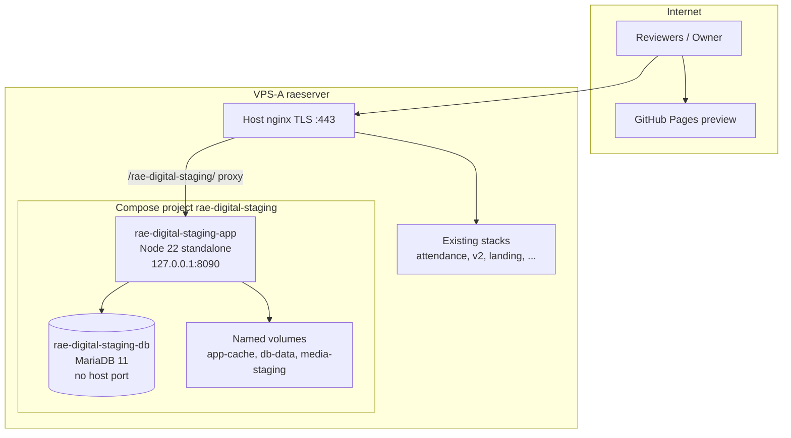

# 4 — Isolated Staging Architecture (Design Only)

**Date:** 2026-10-26  
**Principles:** Separate compose project, network, volumes, secrets, and logs from attendance/Joomla/LiteLLM stacks. No shared production database. Loopback-only upstream. GitHub Pages remains the **public** preview channel until owner cutover.

---

## 4.1 Logical diagram



---

## 4.2 Compose project (proposed filenames — **not committed as runnable stack in this PR**)

| Item | Value |
|---|---|
| Project name | `rae-digital-staging` |
| Working directory (on host) | `/opt/rae-digital-staging` (owner-created) |
| Network | `rae-digital-staging-net` (internal bridge) |
| Volumes | `rae-digital-staging-db-data`, `rae-digital-staging-media`, `rae-digital-staging-logs` |

**Services (phase-aligned):**

### Phase 1 — Public preview on VPS (optional mirror of Pages)

| Service | Image | Ports | Notes |
|---|---|---|---|
| `app` | Built from `Dockerfile.staging` (`node:22-bookworm-slim`, multi-stage `standalone`) | `127.0.0.1:8090:3000` | `NODE_ENV=production`, `NEXT_PUBLIC_*` staging URLs |
| `db` | *omitted* | — | Static export mode needs no DB |

For static-only staging, alternative: nginx `alias` to extracted `out/` artefact (no Node runtime) — lowest resource, matches `NEXT_PAGES_PREVIEW=1` build.

### Phase 2+ — CMS / API / SSO readiness

| Service | Image | Ports | Notes |
|---|---|---|---|
| `app` | same | `127.0.0.1:8090:3000` | Full App Router + route handlers |
| `db` | `mariadb:11.4` | none (expose only on staging net) | Dedicated schema `rae_digital_staging` |
| `worker` | same image as app, different cmd | none | BullMQ/cron skeleton per roadmap |

**SSO (future):** Entra ID app registration **staging** redirect URI only; secrets in `/opt/rae-digital-staging/secrets/` (0600). No reuse of attendance SSO endpoints.

---

## 4.3 Host nginx integration (approval-gated snippet — **do not apply** until owner OK)

Dedicated prefix avoids attendance routing:

```nginx
# STAGING ONLY — owner approval required
location ^~ /rae-digital-staging/ {
    auth_basic           "RAE Digital Staging";
    auth_basic_user_file /etc/nginx/secrets/rae-digital-staging.htpasswd;

    add_header X-Robots-Tag "noindex, nofollow" always;

    proxy_pass         http://127.0.0.1:8090/;
    proxy_http_version 1.1;
    proxy_set_header   Host $host;
    proxy_set_header   X-Forwarded-Proto $scheme;
    proxy_set_header   X-Forwarded-Prefix /rae-digital-staging;
}
```

**TLS:** terminate on existing `raeservice.mju.ac.th` certificate; optional future `staging.raeservice.mju.ac.th` vhost (DNS + certbot — owner).

---

## 4.4 CI/CD (design)

| Stage | Where | Trigger |
|---|---|---|
| Lint, typecheck, test, build | GitHub Actions `ci.yml` | every PR |
| Pages static preview | `pages-preview.yml` | push to `main` |
| VPS staging artefact | **new** workflow `staging-vps.yml` (disabled until approval) | `workflow_dispatch` + environment `staging-vps` |

**Deploy steps (manual first):**

1. CI produces tarball: `.next/standalone` + static assets **or** `out/` for static mode.
2. Owner-run script on VPS: verify checksum, extract to `/opt/rae-digital-staging/releases/<git-sha>/`, flip symlink `current`.
3. `docker compose up -d --no-deps app` with image tag = git SHA.
4. Smoke: `curl -sf -u … https://<host>/rae-digital-staging/healthz`.

No auto-deploy on merge (repo rule + this plan).

---

## 4.5 Secrets & configuration

| Secret | Storage | Never in git |
|---|---|---|
| DB password | `/opt/rae-digital-staging/secrets/db.env` | yes |
| SSO client secret (phase 2) | same dir | yes |
| Basic auth htpasswd | `/etc/nginx/secrets/rae-digital-staging.htpasswd` | yes |

Use Docker secrets or env_file with mode 0600; distinct from attendance `.env` files.

---

## 4.6 Logging isolation

- Compose `logging.options.tag`: `rae-digital-staging/{{.Name}}`
- Optional: forward to existing log stack later — **do not** mix into attendance log paths under `/var/www/attendance-api/logs`.

---

## 4.7 Resource limits (Compose v3 deploy)

```yaml
# illustrative — not applied in this PR
deploy:
  resources:
    limits:
      cpus: "1.5"
      memory: 768M
```

| Service | CPU limit | Memory limit |
|---|---|---|
| `app` | 1.0 | 512M |
| `db` | 0.5 | 512M |
| `worker` | 0.5 | 256M |

---

## 4.8 Coexistence with GitHub Pages

| Channel | Role | Audience |
|---|---|---|
| GitHub Pages | Canonical **public** static preview (`numtip.github.io/rae-digital-platform/…`) | Open |
| VPS staging | Authenticated parity check, future SSR/API/SSO | Owner + reviewers |

Production cutover (Phase 6 per architecture) remains a **separate** approved nginx/DNS change.

---

## 4.9 Future modules (CMS, API, SSO, DB)

Architecture repo already defines modular monolith boundaries (`docs/architecture/RAE_PLATFORM_ARCHITECTURE.md`, `DATABASE_AND_API_BLUEPRINT.md`). Staging isolation preserves ability to:

- Run Prisma migrations against **staging DB only**
- Test OIDC callback URLs without touching attendance SSO
- Enable CSP report-only and admin route guards under `/admin` on staging prefix or subdomain

**ISOLATION_DESIGN_PASS:** Design satisfies separation, port plan, and phase alignment; implementation files intentionally deferred to post-approval PR.
